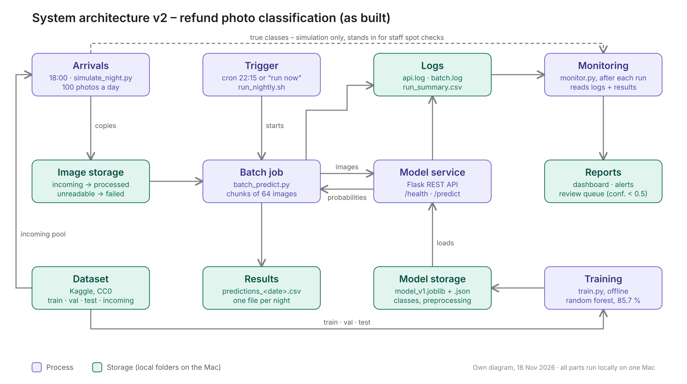

# Refund Item Classification – From Model to Production

Course project for DLBDSMTP01 (Project: From Model to Production), Task 2.

A shop for sustainable products receives photos of returned items. This project sorts those photos into five item classes (shoes, pants, dress, shirt, shorts) automatically:

- a simple **scikit-learn model** classifies each photo,
- the model runs as a **REST service** (Flask),
- a **nightly batch job** sends all new photos to the service and saves the results,
- a **monitoring script** checks every run and lists the photos a person should review.

Everything runs locally on one computer. The focus is on getting the model into production, not on model accuracy.

**Quick start:** the trained model is included, so after [Setup](#setup) you can [start the API](#start-the-api) straight away. The dataset is only needed for training and for the nightly batch.

## Contents

1. [Architecture](#architecture)
2. [Project structure](#project-structure)
3. [Requirements](#requirements)
4. [Setup](#setup)
5. [Data](#data)
6. [Train the model](#train-the-model)
7. [Start the API](#start-the-api)
8. [Run the nightly batch](#run-the-nightly-batch)
9. [Monitoring](#monitoring)
10. [Tests](#tests)
11. [Results](#results)
12. [Known limitations](#known-limitations)
13. [Sources](#sources)

## Architecture



1. **Training (offline):** `src/train.py` trains the model on the train and validation images and saves it with its class names and preprocessing settings in `models/`.
2. **Arrivals:** every day at 18:00, `src/simulate_night.py` copies 100 new "refund photos" from the incoming pool (images never used in training) into `data/incoming/`.
3. **Trigger:** at 22:15, cron starts `run_nightly.sh`, which starts the API, runs the batch job, stops the API and then runs the monitoring. The same script can be started by hand at any time ("run now").
4. **Batch job:** `src/batch_predict.py` sends the new photos to the API in chunks of 64, writes one row per photo to `results/predictions_<date>.csv` and moves the photo to `data/processed/` (or `data/failed/` if it cannot be read). A second run never processes a photo twice.
5. **Model service:** `src/api.py` answers `POST /predict` with the probability of every class.
6. **Monitoring:** `src/monitor.py` reads the logs and results, raises alerts and writes a dashboard and a review queue of unsure photos.

## Project structure

| Path | Content |
|---|---|
| `src/` | Python code (see the steps below) |
| `tests/` | Automated tests (`pytest`); they need no data and no trained model |
| `docs/` | Architecture diagrams, model report, confusion matrix |
| `run_nightly.sh` | The nightly run: API → batch job → monitoring |
| `requirements.txt` | Python packages with exact versions |
| `project_log.md` | Decisions, problems and solutions, in order |
| `data/` | Images and split file (not on GitHub, see [Data](#data)) |
| `models/` | The trained model v1 (`model_v1.joblib`, about 15 MB) and its metadata (`model_v1.json`) |
| `results/`, `logs/`, `reports/` | Created when the system runs (not on GitHub) |

## Requirements

- **Python 3.12 or newer** (tested with 3.14 on macOS and 3.13 on Linux; the pinned numpy and scipy versions do not install on 3.11)
- **Git**
- **macOS or Linux** for `run_nightly.sh` and cron. On Windows the Python steps work, but the nightly script and cron are not tested.
- A free **Kaggle account** to download the dataset (about 270 MB)

Run **all commands from the project folder** (the folder this README is in).

## Setup

```bash
git clone https://github.com/nosadfountains/DLBDSMTP01_Project-From-Model-to-Production-Environment.git
cd DLBDSMTP01_Project-From-Model-to-Production-Environment
python3 -m venv .venv
source .venv/bin/activate        # Windows: .venv\Scripts\activate
python -m pip install -r requirements.txt
```

Check the installation (takes a few seconds):

```bash
python -m pytest
```

Result you should get: `26 passed`.

## Data

This project uses the **Apparel images dataset** by trolukovich, published on Kaggle under the CC0: Public Domain licence:
https://www.kaggle.com/datasets/trolukovich/apparel-images-dataset

The dataset contains 11,385 images in 24 folders named `colour_item` (e.g. `black_dress`). For this project the colours are merged into five item classes:

| Class | Images |
|---|---|
| shoes | 3,418 |
| pants | 2,789 |
| dress | 2,570 |
| shirt | 1,686 |
| shorts | 922 |

The images are not stored in this repository. To reproduce:

1. Log in to Kaggle and download the dataset as a zip file (about 270 MB) from the link above.
2. Unzip it into `data/raw/` inside the project folder:
   ```bash
   mkdir -p data/raw
   unzip -q path/to/archive.zip -d data/raw
   ```
   Afterwards `data/raw/` should contain the 24 `colour_item` folders directly (e.g. `data/raw/black_dress/`).
3. Check the data:
   ```bash
   python src/check_data.py
   ```
   Result you should get: 11,385 images, 0 broken.
4. Split the data into train, validation, test and an "incoming" pool:
   ```bash
   python src/split_data.py
   ```
   The images are not copied or moved. The script writes `data/split.csv` with one row per image (path, colour, class, split). It first removes exact duplicate images and images saved under two different classes, then splits per colour_item folder with a fixed seed (42):

   | Split | Images | Used for |
   |---|---|---|
   | train | 6,822 | training the model |
   | val | 1,706 | comparing model settings |
   | test | 1,706 | final evaluation, used once |
   | incoming | 1,138 | never used in training; simulates new refund photos for the nightly batch |

   Result you should get: 11,372 images after removing 13 (duplicates and one image with conflicting classes).

## Train the model

The trained model is already in `models/`, so this step is **optional**: it shows that the code rebuilds the same model. Training overwrites `models/model_v1.joblib`.

```bash
python src/train.py
```

Takes a few minutes, most of it for reading the images. The script compares a baseline and three scikit-learn models on the validation images, picks the best by macro F1 (a random forest on 64×64 grayscale pixels), retrains it on train + validation and evaluates it **once** on the test images. It writes:

- `models/model_v1.joblib` (about 15 MB) and `models/model_v1.json` (classes, preprocessing settings, metrics, library versions)
- `docs/model_report_v1.txt` and `docs/confusion_matrix_v1.png`

Result you should get: test accuracy 0.857 and macro F1 0.835 (very small differences are possible on other computers or library versions).

The model file only loads reliably with the scikit-learn version from `requirements.txt`. A `.joblib` file can run code when it is loaded, so only load model files from a source you trust.

To check that the saved model loads and reproduces these numbers (needs the dataset):

```bash
python src/evaluate_model.py
```

## Start the API

```bash
python src/api.py
```

The API runs on `http://127.0.0.1:8000` (not port 5000, which macOS uses for AirPlay). Stop it with `Ctrl+C`. Every request is logged in `logs/api.log`.

| Endpoint | What it does |
|---|---|
| `GET /health` | `200` if the model is loaded, otherwise `503` |
| `GET /model-info` | Model version, classes, preprocessing settings, test metrics |
| `POST /predict` | One or more images in, class probabilities out (at most 64 images and 50 MB per request) |

Example, in a second terminal:

```bash
curl http://127.0.0.1:8000/health
curl -F "images=@data/raw/black_dress/<any file name>.jpg" http://127.0.0.1:8000/predict
```

Answer (shortened):

```json
{"model_version": "v1", "n_images": 1, "n_failed": 0,
 "predictions": [{"id": "....jpg", "status": "ok", "top_class": "dress", "confidence": 0.81,
                  "probabilities": {"dress": 0.81, "pants": 0.02, "shirt": 0.05, "shoes": 0.03, "shorts": 0.09}}]}
```

Send several images with several `-F "images=@..."` parts, or use the test client, which sends 5 random test images:

```bash
python src/predict_client.py
```

Errors are answered with a short JSON message: `400` no images, `413` too many images, `503` no model loaded, `404` wrong address, `500` unexpected error (details only in `logs/api.log`). An image that cannot be read gets `"status": "error"`; the other images in the same request are still predicted.

## Run the nightly batch

**Run now** (about one minute; the API does not need to be running, the script starts and stops it):

```bash
python src/simulate_night.py     # delivers 100 new photos to data/incoming/
./run_nightly.sh                 # API -> batch job -> monitoring
```

The last line should be `=== Finished with exit code 0 ===`. On macOS a line such as `Terminated: 15` may appear just above it; that is normal and means the script stopped the API on purpose.

What the run produces:

| File | Content |
|---|---|
| `results/predictions_<date>.csv` | One row per photo: id, time, model version, top class, confidence, probability of every class |
| `results/review_queue_<date>.csv` | Photos with confidence below 0.5, most unsure first, for a person to check |
| `logs/run_summary.csv` | One row per run: status, photos found, predicted, failed, left, duration |
| `logs/batch.log`, `logs/api.log` | What happened, line by line |
| `reports/` | Monitoring report and dashboard (see [Monitoring](#monitoring)) |

Running the script again is always safe: handled photos have left `data/incoming/`, and if the API is down the photos simply wait for the next run. The incoming pool (1,138 photos) lasts for about 11 deliveries of 100.

**Schedule it with cron** (macOS and Linux). Open the cron table with `crontab -e` and add these two lines, with your own project path instead of `/path/to/project`:

```
0 18 * * *  cd /path/to/project && mkdir -p logs && .venv/bin/python src/simulate_night.py >> logs/cron.log 2>&1
15 22 * * * /path/to/project/run_nightly.sh >> /path/to/project/logs/cron.log 2>&1
```

Show the active lines with `crontab -l`. Cron only runs while the computer is awake: a missed evening is not caught up, but nothing is lost either, because the photos wait in `data/incoming/` for the next run. On macOS, cron may not be allowed to read folders such as Documents or Desktop; a folder like `~/Projects` works.

## Monitoring

```bash
python src/monitor.py
```

`run_nightly.sh` runs this automatically after every batch. It only reads what the API and the batch job wrote, so it cannot break them. It writes `reports/monitoring_report.txt` (alerts and one row per night), `reports/dashboard.png` (one picture of the last two weeks) and `reports/nightly_metrics.csv`, and logs every alert in `logs/monitor.log`.

| Check | Alert when |
|---|---|
| Last run | ended with a status other than `ok` (critical) |
| Missed runs | no run with new photos for more than 26 hours |
| Waiting photos | photos still in `data/incoming/` after the last run |
| Unreadable photos | photos moved to `data/failed/` |
| API | error lines in `api.log`, or a request slower than 5 seconds |
| Unsure predictions | more than 30 % of a night below confidence 0.5 |
| Drift | a class share more than 15 percentage points away from the training data |
| Accuracy | more than 10 points below the test set (85.7 %) |

The model checks only judge nights with at least 30 photos. All thresholds are at the top of `src/monitor.py`.

**About accuracy:** in real life the true class of a nightly photo is unknown. In this simulation, `simulate_night.py` writes the true classes to `data/delivered_labels.csv`; the batch job never reads this file, and the monitoring uses it in place of staff who check photos by hand. The report also compares review thresholds from 0.4 to 0.7 (share of photos a person checks, mistakes caught, accuracy of the rest).

## Tests

```bash
python -m pytest
```

26 tests: preprocessing (4), API (8), batch job (5) and monitoring (9). They use a tiny stand-in model and temporary folders, so they need neither the dataset nor a trained model and never touch your real results.

## Results

| Measure | Value |
|---|---|
| Test accuracy (1,706 test images, used once) | 85.7 % (baseline that always guesses "shoes": 30 %) |
| Macro F1 (test) | 0.835; weakest class shorts (F1 0.674) |
| Nightly runs (420 incoming photos with known class) | 86.2 % accuracy, 0 failed runs, 0 unreadable photos |
| Review threshold 0.5 | about 1 in 5 photos checked by a person, about 3 in 4 mistakes caught |

Details: `docs/model_report_v1.txt`, `docs/confusion_matrix_v1.png` and `project_log.md`.

## Known limitations

- **Simple model:** a random forest on 64×64 grayscale pixels; a pretrained neural network would be more accurate. Shorts are missed most often (about 1 in 3).
- **Data:** studio and web images, not real refund photos; some colour/item combinations are missing (e.g. no red shirts).
- **Local only:** everything runs on one computer; runs happen only while it is awake. A server or cloud deployment would run every night.
- **The API starts only for the nightly run** and has no login and no HTTPS; it listens only on the computer itself (127.0.0.1).
- **No active notification:** alerts are written to a report and a log file, nobody is e-mailed.
- **Ground truth is simulated:** real accuracy would need staff to label a sample of photos.

## Sources

- trolukovich: *Apparel images dataset*. Kaggle, licence CC0: Public Domain. https://www.kaggle.com/datasets/trolukovich/apparel-images-dataset
- Python packages and versions: see `requirements.txt` (scikit-learn, Flask, pandas, NumPy, Pillow, Matplotlib, requests, pytest)
